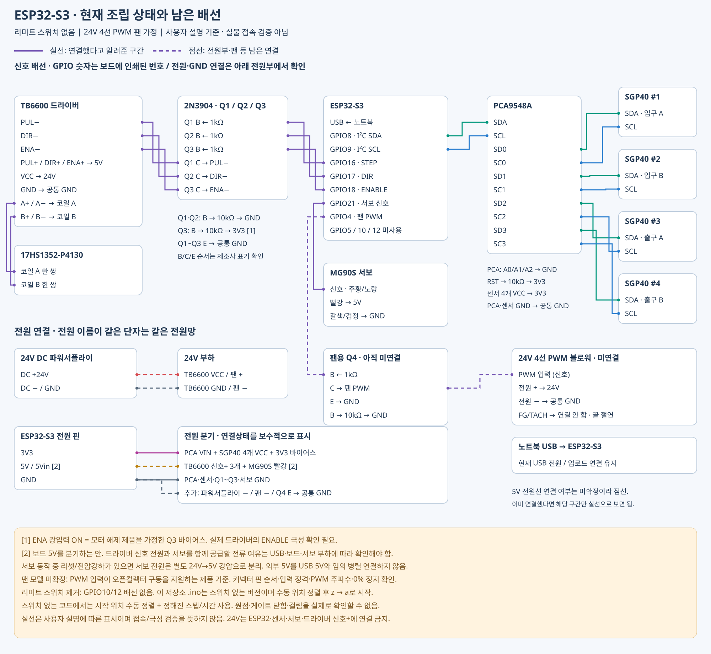
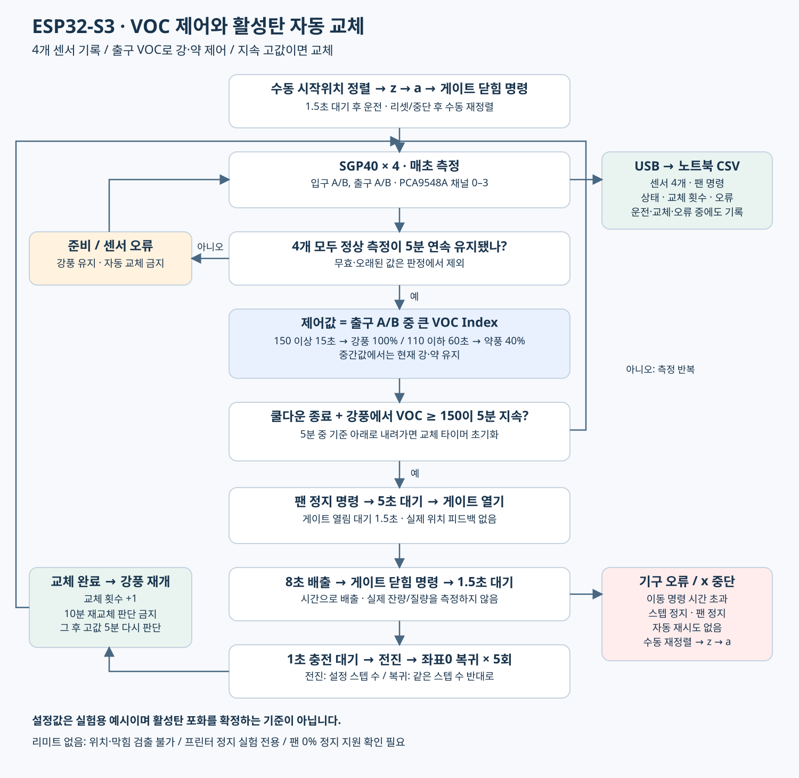

# ESP32-S3 · 리미트 스위치 없는 버전 (2026-11-04)

ESP32-S3 기반 VOC 필터 자동제어 프로젝트입니다. 리미트 스위치 없이 동작하는 버전입니다. 센서4개, PCA9548A, TB6600+NPN, MG90S, 24V4선PWM팬 구성입니다. 현재 팬/전원부가 미연결이므로 기본값에서는 센서 측정과 CSV만 동작합니다.

## 달라진 점
- GPIO10/12 스위치 입력, 자동 원점 탐색, 게이트 닫힘 확인을 모두 제거했습니다.
- 셔틀은 사용자가 정렬한 시작 위치=0에서 `STROKE_STEPS`로 전진하고 `moveTo(0)`으로 복귀합니다.
- 서보는 열기/닫기 명령 뒤 각각 설정시간을 기다립니다. 실제 도달 피드백은 없습니다.
- 리셋/오류/중단 뒤에는 다시 수동 정렬→`z`→`a`가 필요합니다. 이전 위치를 자동 복원하지 않습니다.
- 정상 운전 대기 중 스텝 드라이버는 활성 유지하여 위치 유지를 돕습니다. x 또는 오류 시 해제합니다.
- VOC 강약, 자동교체 조건, 10분 쿨다운과 CSV 열 구성은 유지했습니다.

## 지금 센서만 확인할 때
1. Arduino IDE: **ESP32S3 Dev Module**, Espressif Systems esp32 **3.x** 선택.
2. 라이브러리 **Adafruit SGP40 Sensor**(의존성 모두), **AccelStepper** 설치.
3. `firmware/VOC_Controller_S3_Simple/VOC_Controller_S3_Simple.ino` 열어 업로드.
4. 115200 시리얼 모니터에서 CSV 형식으로 센서 값 확인. IDLE은 시작 대기이며 고장이 아닙니다.
5. `MECHANICS_VERIFIED=false`, `FAN_STOP_VERIFIED=false`는 현재 그대로 두세요. `a`를 보내도 `VERIFY_CONFIG`를 표시하고 기구를 움직이지 않습니다.

## 전원/팬 연결 후 최초 설정
코드 상단에서 아래 값을 실물에 맞춥니다. 숫자는 모두 예시입니다.

| 설정 | 기본 | 확인할 내용 |
|---|---:|---|
| STROKE_STEPS |800|셔틀 편도 거리. TB6600 마이크로스텝 설정에 따라 변경|
| DIR_INVERT |false|양의 스텝이 호퍼→공급 방향인지|
| GATE_CLOSED_US |1100|MG90S 닫힘 위치 펄스폭|
| GATE_OPEN_US |1900|MG90S 열림 위치 펄스폭|
| GATE_CLOSE_WAIT_MS / GATE_OPEN_WAIT_MS |1500 / 1500|서보 도달 대기. 센서 확인이 아님|
| REFILL_STROKES |5|실제 1회 공급량을 계량하여 결정|
| DUMP_MS / FILL_MS |8000 / 1000|배출/충전 대기시간|
| MOVE_SPEED / ACCELERATION |200 / 300|펄스/s 및 펄스/s²|
| MOVE_TIMEOUT_MS |20000|각 편도 명령 완료 제한시간|
| FAN_FREQUENCY / FAN_LOW_PERCENT |25000 / 40|선택한 팬의 주파수/약풍 재기동 조건|
| FAN_STOP_WAIT_MS |5000|팬0% 정지가 가능한 제품에서 실측 정지시간 이상|
| ENABLE_ACTIVE_LOW |true|GPIO LOW=NPN OFF일 때 활성인 드라이버 가정|

이동량·방향·서보 위치를 확인하면 `MECHANICS_VERIFIED=true`.
팬0% 정지와 주파수/정지시간을 확인하면 `FAN_STOP_VERIFIED=true`로 변경 후 재업로드합니다.
이 설정은 처음 조정할 때의 잠금이며 매 교체 때 승인을 요구하지 않습니다.

## 매 운전 시작 / 중단 뒤 재시작
1. 기구가 정지하고 드라이버가 해제된 상태에서 셔틀을 **완전히 복귀한 기준 위치**로 수동 정렬합니다. 모터 구동 중 손으로 강제 이동하지 마세요.
2. 시리얼 모니터에서 `z` 전송: 현재 위치를 소프트웨어 좌표0으로 지정합니다. 이 명령 자체는 모터를 움직이지 않습니다.
3. `a` 전송: 서보 닫힘 명령→1.5초 대기→팬 강풍 운전. 스텝은 위치 유지를 위해 활성화됩니다.
4. 중단은 `x`. 팬0%/스텝 해제, 서보는 마지막 위치 명령 유지. 좌표 확인이 취소되므로 다시 수동 정렬→z→a.

`z`는 센서 확인이 아닌 **사용자의 시작위치 확인 선언**입니다. 자동운전 중 z/a는 무시됩니다. 손으로 움직이거나 탈조하면 실제 위치와 코드 좌표가 달라지므로 중단 후 재정렬해야 합니다.

## 자동 제어 순서
- 4개 센서 모두 유효한 값이 연속5분 유지되기 전에는 강풍, 자동교체 금지.
- 출구A/B 중 큰 VOC Index 사용. 150 이상15초→강풍100%,110 이하60초→약풍40%. 111~149에서는 직전 풍량 유지.
- 강풍에서150 이상5분 연속 지속→교체. 중간에149 이하이면 교체 타이머 초기화.
- 팬0%→5초대기→게이트열기→1.5초대기→8초배출→게이트닫기→1.5초대기→1초충전→설정스텝전진→좌표0복귀. 충전/전진/복귀를5회 반복.
- 완료 후 강풍,10분 재교체 금지. 이후 다시 고값5분 조건을 만족해야 교체.
- 센서 오류 시 정화 중 강풍, 자동교체 판정 금지. 정상5분 확인부터 다시 시작. 이미 진행 중인 교체 순서는 센서 오류만으로 중단하지 않습니다.
- 이동 명령 제한시간 초과 시 ERROR. 펄스 전송 완료만 감시하며 **기계적 걸림/탈조/실제 위치를 검출하지 못합니다.**

프린터가 멈춘 실험용입니다. 프린터 상태 인터록은 없습니다. VOC 지속 고값은 실험적 교체 규칙이며 활성탄 포화의 증명이 아닙니다. VOC Index는 ppm이 아니고 입출구 비율로 제거효율을 계산할 수 없습니다. 온습도 보정은25°C/50%RH 가정입니다.

## CSV 파일 저장 (Windows)
시리얼 모니터를 닫고 저장소 루트 폴더에서 터미널을 실행합니다.

```console
py -m pip install -r requirements.txt
py tools/log_voc_csv.py --port COM7
```

위 명령은 센서 기록만 시작합니다. 실제 포트가 다르면 COM7을 바꾸세요.
기구 설정 및 수동 정렬 완료 후 운전과 기록을 함께 시작할 때:

```console
py tools/log_voc_csv.py --port COM7 --start --origin-confirmed --stop-on-exit
```

이 명령은 연결2초 후 z와 a를 전송합니다. **실제 셔틀을 기준 위치에 맞춘 경우에만 사용합니다.** `--start`만 주면 위치 확인 누락으로 실행을 거부합니다.
Ctrl+C는 기록 종료이며 위`--stop-on-exit` 옵션이 있으면 x도 보냅니다. USB 단선/프로그램 강제종료 시 정지는 보장되지 않습니다. 포트를 다시 열면 일부 보드는 리셋될 수 있습니다.
CSV는 같은 폴더의 `voc_날짜_시간.csv`에 약1초마다 저장됩니다. SD카드나 ESP32 내부 저장은 없으며 노트북 연결과 저장 프로그램 실행이 필요합니다.

CSV열: pc_time_utc, boot_segment, seq, uptime_ms, voc_in_a, voc_in_b, voc_out_a, voc_out_b, valid_mask, control_voc, fan_command_pct, state, replacements, cooldown_s, fault.
무효 센서값은 빈칸,valid_mask15=모두유효. fan_command_pct는 명령값이며 실측RPM이 아닙니다. RETURN은 실제 원점 검출이 아니라 좌표0으로의 펄스 복귀입니다.

## GPIO 유지
| 기능 | GPIO |
|---|---:|
| PCA SDA / SCL |8 / 9|
| STEP / DIR / ENABLE (각 NPN 경유) |16 / 17 / 18|
| MG90S 신호 |21|
| 팬 PWM (NPN 경유, 코드에서 반전) |4|
| 미사용 |5(FG),10/12(스위치)|

전원 배선은 아래 스위치 없는 배선도 기준입니다. 보드5V에서 서보/드라이버 신호+를 분기하는 경우 USB·보드의 공급 용량은 별도로 확인해야 합니다. 이 코드가 전원 용량이나 팬 모델 호환성을 보장하지는 않습니다.

## 검증 범위
호스트 C++ 스텁 환경에서 무스위치 교체 순서,5회 왕복의 절대 목표좌표,쿨다운,센서 무효,명령/위치확인,시간초과,중단을 검사했습니다. Python 문법 검사도 수행했습니다. 실제 ESP32 툴체인 컴파일·업로드·기구 운전은 수행하지 못했습니다.

## 도면

### 배선 상태

실선=연결 보고 구간, 점선=미연결/전원 연결 확인이 필요한 구간.



### 제어 로직


